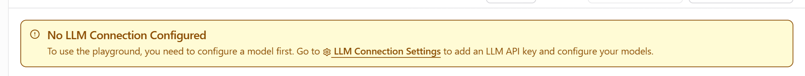
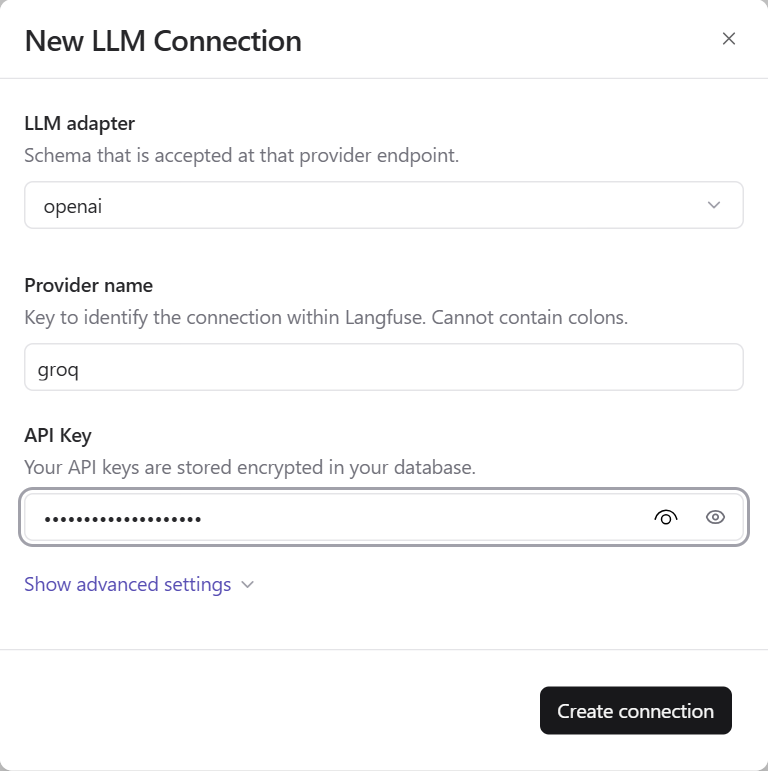
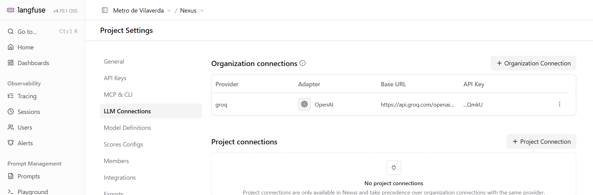

# 01 · Dos prompts y una discusión

> «Marc y Jordi no se ponen de acuerdo sobre el prompt. Decide tú.»

La primera semana, la mitad de los viajeros habló con el prompt de Marc (**v1**) y la
otra mitad con el de Jordi (**v2**). Jordi dice que el suyo gusta más. Marc, que el suyo
es más fiable. Laia quiere una decisión hoy, y una explicación con datos.

Primero probarás los dos prompts a mano en el Playground, como haría cualquiera en el
equipo. Después mirarás lo que pasó con tres semanas de viajeros reales y verás si tu
primera impresión aguanta.

**Tiempo:** 45 minutos (15 de Playground y 30 de datos y código) · **Comprobación:**
`uv run check 1`

## Lo que necesitas saber

**Los prompts viven fuera del código.** Nexus no lleva sus prompts escritos en el
código que se despliega: los pide a Langfuse al empezar cada ejecución. Así se puede
cambiar un prompt sin desplegar.

- **Cada cambio es una versión** (v1, v2, v3…) y una versión no se modifica después.
- **Un label es un puntero a una versión.** El código pide `nexus/executor` con el label
`production`. Mover el label a otra versión es desplegar; devolverlo a la anterior es
hacer rollback. No hace falta publicar nada nuevo.
- **Fallback:** si Langfuse no responde, Nexus tiene que seguir funcionando con el prompt
que hay en el código.
- **La configuración viaja con la versión.** La temperatura del modelo se guarda en el
`config` de cada versión del prompt.
- **Caché:** Nexus guarda el prompt 60 segundos. Si mueves un label, tarda hasta un
minuto en notarse.
- **Cada generación queda enlazada a la versión que la produjo.** Por eso en Langfuse
puedes filtrar y comparar trazas por versión del prompt.

**El Playground sirve para tener hipótesis, no conclusiones.** Es un chat dentro de
Langfuse donde pruebas un prompt con el modelo que quieras, sin tocar el código. Va bien
para probar rápido una pregunta con dos prompts, otro modelo u otra temperatura. Pero un
caso no es evidencia, y el Playground no ejecuta el grafo de Nexus ni llama a sus
herramientas. La secuencia es: Playground → hipótesis → datos o experimento (capítulo 3)
→ decisión.

## La misión

### Primera parte: prueba los dos prompts en el Playground

#### Conecta Langfuse con el modelo

El Playground llama al modelo desde Langfuse, no desde Nexus, así que Langfuse necesita
su propia conexión con el proveedor: una **LLM Connection**. Se configura una vez por
proyecto y la usarán también el juez del capítulo 3 y los evaluadores de la UI.

1. Abre **Playground** en el menú de la izquierda. Mientras no haya ninguna conexión,

   Langfuse te avisa de que falta configurar un modelo:

     
2. Pulsa **LLM Connection Settings** en el aviso (es lo mismo que **Settings → LLM

   Connections**) y después **+ Organization Connection**. Una conexión de la
     organización sirve para todos sus proyectos; la de proyecto solo para Nexus.
3. Rellena la primera parte del formulario. Groq acepta el mismo formato que la API de

   OpenAI, así que el adaptador es `openai`:
     | Campo | Valor |
     | --- | --- |
     | LLM adapter | `openai` |
     | Provider name | `groq` |
     | API Key | tu clave de Groq, la misma que `GROQ_API_KEY` en tu `.env` (empieza por `gsk_`) |

     
4. Pulsa **Show advanced settings** y rellena el resto. Sin la URL base, Langfuse

   llamaría a OpenAI con tu clave de Groq:
   | Campo                 | Valor                                                  |
   | --------------------- | ------------------------------------------------------ |
   | API Base URL          | `https://api.groq.com/openai/v1`                       |
   | Use Responses API     | desactivado                                            |
   | Enable default models | desactivado: los modelos por defecto son los de OpenAI |
   | Custom models         | > `groq:qwen/qwen3.8-27b`                              |

     
5. Pulsa **Create connection**.

   Qué esperar: la conexión `groq` aparece en **Organization connections**, con el
     adaptador OpenAI, la URL de Groq y solo los últimos caracteres de la clave.

     

Si al usarla en el Playground sale un error de autenticación, revisa la clave; si sale un
error de modelo, revisa que el nombre en **Custom models** es exactamente

`groq:qwen/qwen3.8-27b`


> [!NOTE]
> La clave se guarda cifrada en la base de datos de tu Langfuse, que corre en tu
> portátil. No sale de él salvo para llamar a Groq.

#### Abre los dos prompts lado a lado

1. Ve a **Prompts → nexus/executor**, elige la **versión 1** y pulsa **Playground**. Se

   abre un chat con los mensajes de esa versión.

     <!-- Captura pendiente:  -->
2. Arriba, elige el modelo: conexión `groq` y modelo `llama-3.3-70b-versatile`. Pon la

   **temperatura** de la versión a mano: el Playground no la lee del `config` del
     prompt. Mírala en la pestaña **Config** de la versión: 0,2 en la v1 y 0,9 en la v2.
3. El prompt tiene tres **variables** entre llaves dobles, que Nexus rellena en cada

   conversación. En el Playground las rellenas tú, en el panel de variables:
     | Variable | Valor para copiar |
     | --- | --- |
     | `viajero` | `Laura (id 1001), escribe en castellano, título tmes` |
     | `hoy` | `lunes 16 de noviembre de 2026` |
     | `tool_catalog` | el bloque de abajo |
4. Añade una **segunda ventana** al Playground y carga en ella la **versión 2**, con su

   temperatura (0,9) y las mismas variables. Así lanzas la misma pregunta a los dos
     prompts a la vez.

     <!-- Captura pendiente:  -->

Qué esperar: dos ventanas con el mismo modelo, cada una con su prompt, su temperatura y
las variables rellenas.

#### Tres preguntas de viajeros

Escribe cada pregunta como mensaje del usuario en las dos ventanas y lánzala. Repite cada
una dos o tres veces:

1. «¿A qué hora pasa el primer tren de la L1 por Plaça Major mañana?»
2. «¿Puedo llevar el patinete eléctrico en el metro?»
3. «Ayer la L2 iba con retraso y perdí el tren. ¿Me devolvéis el viaje?»

Para cada pregunta, apunta qué ventana te gusta más y por qué: el tono, la longitud, si
da una respuesta concreta o si dice que tiene que consultarlo. ¿Las respuestas de cada
ventana se parecen entre sí cuando repites?

Ahora piensa qué **no** puedes saber desde aquí. En el Playground no hay herramientas:
el prompt las describe, pero nadie las ejecuta. Si alguna ventana te da una hora
concreta para la primera pregunta, ¿de dónde la ha sacado? Además, son tres preguntas
contra cientos de viajeros, y tu opinión sobre el tono no es la de ellos.

Apunta tu favorita en una frase. Es tu **hipótesis**; la segunda parte la pone a prueba.

### Segunda parte: lo que dicen tres semanas de producción

1. **Compara las dos versiones.** En **Tracing**, filtra por la versión del prompt

   `nexus/executor` y compara v1 y v2 en valoración de los viajeros (score
     `user_feedback`), latencia y tokens. También puedes verlo en **Prompts →
     nexus/executor**, en las métricas de cada versión.
2. **Segmenta.** Abre el dashboard **«Nexus en producción»** y repite la comparación

   **por categoría** de consulta: horarios, incidencias, normativa, tarifas…
3. **Mira trazas concretas.** Abre 3 trazas de horarios de cada versión. ¿Qué

   herramienta llamó cada una? ¿Coincide la hora de la respuesta con lo que devolvió la
     herramienta?
4. **Vuelve a tu hipótesis.** ¿Lo que viste en el Playground se confirma con los datos?

### Tercera parte: en el código

1. Abre `nexus/llm/prompts.py` y completa `langfuse_prompt()`: tiene que leer el prompt

   **por label** (el que devuelve `active_label()`) y pasar a `get_prompt()` como
     `fallback` los mensajes del prompt del código (`PROMPTS_BY_NAME[name].messages`).
2. Deja en `production` la versión que elijas. No publiques una versión nueva: la que

   quieres ya existe, solo hay que **mover el label**. Tienes dos formas:
   - **Desde la UI:** **Prompts → nexus/executor** → la versión elegida → edita sus
    labels y añade `production`.
   - **Desde la terminal:** indica el prompt, la versión y el label. Por ejemplo, para
    la versión 1:
     ```bash
     uv run prompts --name nexus/executor --version 1 --label production
     ```

     Qué esperar: el comando responde con los labels que tiene ahora la versión, por
     ejemplo `nexus/executor: versión 1 con labels marc, production`. Langfuse quita
     `production` de la versión que lo tenía antes, porque un label solo puede estar en
     una versión.

Comprueba:

```bash
uv run check 1
```

## Sabrás que lo has hecho si…

- `uv run check 1` sale en verde. Comprueba que Nexus sigue funcionando con Langfuse
caído y que la versión `production` del executor no usa una temperatura alta.
- Puedes explicar tu decisión **en una frase con un dato**. Por ejemplo: «Me quedo con la
vX porque en ‹categoría› ‹dato›».
- Sabes decir en qué se parecía y en qué no tu impresión del Playground a lo que dicen
los datos.

Pista 1 · El Playground da un error al lanzar

Si dice que falta una variable, rellena las tres (`viajero`, `hoy` y `tool_catalog`).
Si es un error de autenticación o de modelo, revisa la LLM Connection: la clave, la URL
base `https://api.groq.com/openai/v1` y el nombre exacto del modelo en **Custom models**.

Pista 2 · No sé por dónde empezar a comparar

Empieza por el total de valoraciones positivas de cada versión. Después hazte la
pregunta incómoda: ¿la media es igual en todas las categorías?

Pista 3 · La v2 gusta más, ¿dónde está el problema?

Abre trazas de **horarios** de la v2 y mira el árbol: ¿hay alguna llamada a
`consultar_horario` antes de la respuesta? Luego mira el `config` de cada versión en
Prompts.

Pista 4 · El check dice que la temperatura es alta

`production` apunta a una versión cuyo `config.model.temperature` es mayor que 0,3.
Mueve el label a una versión con temperatura baja:
`uv run prompts --name nexus/executor --version 1 --label production`. Si de verdad
prefieres el texto de la v2, crea desde la UI una versión nueva con ese texto y una
temperatura baja, y ponle el label a esa.

## Para pensar

- ¿Qué habrías decidido solo con el Playground? ¿Y mirando solo la media?
- Un viajero puntúa la respuesta en el momento, antes de comprobar si era verdad. ¿Qué
puede detectar el feedback de los viajeros y qué no?

Siguiente: [02 · El viajero enfadado](02-el-viajero-enfadado.md).
