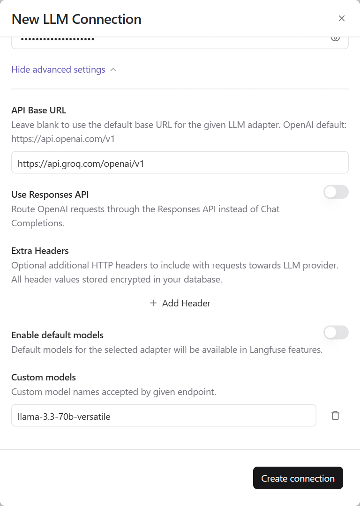

# 01 · Dos prompts y una discusión

> «Marc y Jordi no se ponen de acuerdo sobre el prompt. Decide tú.»

La primera semana, la mitad de los viajeros habló con el prompt de Marc (**v1**) y la
otra mitad con el de Jordi (**v2**). Jordi dice que el suyo gusta más. Marc, que el suyo
es más fiable. Hoy hay que dejar en producción una de las dos versiones y explicar la
decisión con datos.

Primero probarás tú los dos prompts en el Playground y te harás una primera impresión.
Después mirarás qué dicen los viajeros y, por último, desplegarás la versión que elijas.

**Cuaderno:** sección 01 de [`CUADERNO.md`](../CUADERNO.md)

## Lo que necesitas saber

**Los prompts viven fuera del código.** Nexus no lleva sus prompts escritos en el
código que se despliega: los pide a Langfuse al empezar cada ejecución. Así se puede
cambiar un prompt sin desplegar.

- **Cada cambio es una versión** (v1, v2, v3…) y una versión no se modifica después.
- **Un label es un puntero a una versión.** El código pide `nexus/executor` con el label
`production`. Mover el label a otra versión es desplegar; devolverlo a la anterior es
hacer rollback.
- **Fallback:** si Langfuse no responde, o ninguna versión tiene el label que pide,
Nexus tiene que seguir funcionando con el prompt que hay en el código. Ahora mismo
ninguna versión de `nexus/executor` está en `production`: Nexus usa el del código.
- **La configuración viaja con la versión.** La temperatura del modelo se guarda en el
`config` de cada versión del prompt.
- **Caché:** Nexus guarda el prompt 60 segundos. Si mueves un label, tarda hasta un
minuto en notarse.
- **Cada generación queda enlazada a la versión que la produjo.** Por eso en Langfuse
puedes saber qué versión del prompt contestó cada conversación.

**La prueba A/B.** Durante la primera semana (26 de octubre – 1 de noviembre), cada
conversación fue a una de las dos versiones, al azar. En Langfuse se distinguen por su
**release**:

| Release | Prompt |
| --- | --- |
| `v1-marc` | `nexus/executor` versión 1 |
| `v2-jordi` | `nexus/executor` versión 2 |

**Los viajeros valoran.** Después de usar la respuesta, parte de los viajeros la puntúan
con 👍 o 👎 (score `user_feedback`: 1 o 0), y algunos dejan un comentario. El viajero
sabe si la respuesta le sirvió; no sabe cómo llegó Nexus a ella. Eso está en la traza.

**El Playground sirve para probar un prompt.** Es un chat dentro de Langfuse donde
lanzas un prompt con el modelo que quieras, sin tocar el código, y comparas en segundos
cómo responde cada versión. Pero un caso no es evidencia, y el Playground no ejecuta el
grafo de Nexus ni sus herramientas. Medir de verdad si un prompt es mejor es el capítulo 3.

## La misión

### Primera parte: los dos prompts en el Playground

Antes de mirar ningún dato, prueba los dos prompts con la misma pregunta de una
viajera.

#### Conecta Langfuse con el modelo

El Playground llama al modelo desde Langfuse, no desde Nexus, así que Langfuse necesita
su propia conexión con el proveedor: una **LLM Connection**. Se configura una vez por
proyecto y la usarán también el juez del capítulo 3 y los evaluadores de la UI.

1. Abre **Playground** en el menú de la izquierda. Mientras no haya ninguna conexión,
   Langfuse te avisa de que falta configurar un modelo:

   
2. Pulsa **LLM Connection Settings** en el aviso (es lo mismo que **Settings → LLM
   Connections**) y después **+ Organization Connection**. Una conexión de la
   organización sirve para todos sus proyectos; la de proyecto solo para Nexus.
3. Rellena la primera parte del formulario. Groq acepta el mismo formato que la API de
   OpenAI, así que el adaptador es `openai`:

   | Campo | Valor |
   | --- | --- |
   | LLM adapter | `openai` |
   | Provider name | `groq` |
   | API Key | tu clave de Groq, la misma que `GROQ_API_KEY` en tu `.env` (empieza por `gsk_`) |

   
4. Pulsa **Show advanced settings** y rellena el resto. Sin la URL base, Langfuse
   llamaría a OpenAI con tu clave de Groq:

   | Campo | Valor |
   | --- | --- |
   | API Base URL | `https://api.groq.com/openai/v1` |
   | Use Responses API | desactivado |
   | Enable default models | desactivado: los modelos por defecto son los de OpenAI |
   | Custom models | `qwen/qwen3.8-27b` |

   
5. Pulsa **Create connection**.

   Qué esperar: la conexión `groq` aparece en **Organization connections**, con el
   adaptador OpenAI, la URL de Groq y solo los últimos caracteres de la clave.

   

Si al usarla en el Playground sale un error de autenticación, revisa la clave; si sale un
error de modelo, revisa que el nombre en **Custom models** es exactamente
`qwen/qwen3.8-27b`.

> [!NOTE]
> La clave se guarda cifrada en la base de datos de tu Langfuse, que corre en tu
> portátil. No sale de él salvo para llamar a Groq.

#### Abre la versión 1

Los prompts no se eligen desde el Playground: no tiene ningún selector para cargar un
prompt guardado. Se abren desde la página de cada versión, en **Prompts**, con el botón
**Playground** y la opción **Fresh playground**, que vacía el Playground y abre esa
versión.

1. Ve a **Prompts → nexus/executor**, elige la **versión 1**, pulsa **Playground** y
   elige **Fresh playground**. Encima de los mensajes aparece `nexus/executor` con la
   versión que has cargado.

   <!-- Captura pendiente:  -->
2. Arriba, elige el modelo `groq: qwen/qwen3.8-27b`. Pon la **temperatura** de la
   versión a mano: el Playground no la lee del `config` del prompt. Mírala en la pestaña
   **Config** de la versión.
3. El prompt tiene tres **variables** entre llaves dobles, que Nexus rellena en cada
   conversación. En el Playground las rellenas tú, en **Variables**:

   | Variable | Valor para copiar |
   | --- | --- |
   | `viajero` | `Laura (id 1001), escribe en castellano, título tmes` |
   | `hoy` | `lunes 16 de noviembre de 2026` |
   | `tool_catalog` | el bloque de abajo |

   ```text
   - consultar_horario: Horario de una línea en una estación: primer tren, último tren y frecuencia.
   - consultar_incidencias: Incidencias, obras y cortes de servicio de un día, de una línea o de toda la red.
   - consultar_tarifas: Precios y condiciones de los títulos de transporte (sencillo, T-10, T-Mes...).
   - buscar_normativa: Busca en la normativa y guías de MdV: bicicletas, patinetes, mascotas, equipaje, sanciones, devoluciones, reclamaciones, accesibilidad, títulos y objetos perdidos.
   - buscar_objeto_perdido: Busca un objeto perdido entre los que se han encontrado en la red.
   - abrir_reclamacion: Abre una reclamación a nombre del viajero. (requiere aprobación del viajero)
   - solicitar_devolucion: Solicita la devolución del importe de un viaje. Solo si la normativa la permite. (requiere aprobación del viajero)
   - suscribir_alertas: Suscribe al viajero a los avisos de incidencias de una línea. (requiere aprobación del viajero)
   ```

#### Dale al modelo una herramienta

En el Playground el modelo no tiene herramientas: `tool_catalog` solo se las describe en
texto, y Langfuse no carga las herramientas de Nexus, porque viven en el código. Para ver
si el prompt consulta antes de responder, crea a mano `consultar_horario`.

1. Pulsa **Tools → Create new tool** y rellena el formulario. Son los mismos datos que
   tiene la herramienta en `nexus/tools/horarios.py`:

   | Campo | Valor |
   | --- | --- |
   | Name | `consultar_horario` |
   | Description | `Horario de una línea en una estación: primer tren, último tren y frecuencia.` |
   | Parameters (JSON Schema) | el bloque de abajo |

   ```json
   {
     "type": "object",
     "properties": {
       "linea": { "type": "string", "description": "Línea, por ejemplo \"L1\"." },
       "estacion": { "type": "string", "description": "Nombre o código de la estación, por ejemplo \"Plaça Major\"." },
       "dia": { "type": "string", "description": "\"hoy\", \"mañana\", un día de la semana o una fecha AAAA-MM-DD." },
       "hora": { "type": "string", "description": "Hora HH:MM para saber la frecuencia en ese momento (opcional)." }
     },
     "required": ["linea", "estacion", "dia"],
     "additionalProperties": false
   }
   ```

   Pulsa **Save**. Qué esperar: el botón **Tools** marca **1**.
2. Pulsa **+ Message**, comprueba que el rol es **User** y escribe la pregunta de Laura:

   ```text
   ¿A qué hora pasa el primer tren de la L1 por Plaça Major mañana?
   ```

> [!NOTE]
> El Playground nunca ejecuta las herramientas. Cuando el modelo pida una, el resultado
> lo pondrás tú.

#### Pon la versión 2 al lado

1. Pulsa **New split window**. Se abre una copia de la ventana, con el mismo prompt, el
   modelo, las variables, la herramienta y la pregunta.
2. En la copia, cambia el mensaje **System** por el de la versión 2: cópialo de
   **Prompts → nexus/executor → versión 2**. Pon también su temperatura (pestaña
   **Config**). Ahora tienes la v1 a la izquierda y la v2 a la derecha.

   <!-- Captura pendiente:  -->
3. Pulsa **Run All**, arriba a la derecha, para lanzar las dos ventanas a la vez.

   Qué esperar: en el **Output** de cada ventana, o una tarjeta **Tool called** con
   `consultar_horario` y sus argumentos (`linea`, `estacion`, `dia`), o una respuesta en
   texto. Pulsa **Run All** dos o tres veces y apunta qué hace cada ventana cada vez.
4. **Devuelve el resultado de la herramienta.** En cada ventana que la haya llamado,
   pulsa **+ Add to messages**, en la cabecera de **Output**. La llamada pasa a la
   conversación y debajo aparece un mensaje vacío para el resultado. Pega en él lo que
   habría devuelto Nexus:

   ```json
   {"linea": "L1", "estacion": "Plaça Major", "fecha": "martes 17 de noviembre de 2026", "tipo_dia": "De lunes a jueves no festivos", "primer_tren": "05:04", "ultimo_tren": "00:04", "desde_cabecera": "Port de Vilaverda"}
   ```

   Si el mensaje para el resultado no aparece, añádelo con la flecha **⌄** que hay junto
   a **+ Message**.
5. Pulsa **Run All** otra vez.

   Qué esperar: cada ventana que consultó la herramienta redacta la respuesta final para
   Laura con sus datos.

Compara las dos ventanas: ¿cuál consulta la herramienta antes de responder? ¿Cuál te
gusta más? ¿Dicen las 05:04 y el martes 17, o cambian o añaden algo que la herramienta
no dijo?

Apunta tu primera impresión en el cuaderno. Es una hipótesis: una sola pregunta, y tu
opinión, no la de los viajeros. La segunda parte la pone a prueba.

### Segunda parte: lo que dicen los viajeros

1. **¿Cuál gusta más?** Abre **Dashboards → «Prueba A/B del executor»** y pon un rango
   de fechas que incluya del 26 de octubre al 1 de noviembre de 2026. Compara las dos
   versiones en el total de valoraciones.
2. **¿En qué?** Baja a la comparación **por categoría**. ¿Gana siempre la misma versión?

   ¿Cuántas valoraciones hay detrás de cada número?
3. **¿Qué dicen?** En **Tracing**, filtra por la etiqueta (tag) de la categoría que más
   te llame la atención y abre conversaciones con 👎 de cada versión. El score
   `user_feedback` de cada traza lleva el comentario del viajero, si dejó uno.
4. **¿Por qué?** En esas mismas trazas, recorre el árbol: ¿qué hizo Nexus antes de
   responder? Compáralo con conversaciones de la misma categoría de la otra versión. El
   resto del dashboard te ayuda a ver si lo que encuentras es un caso o la norma.
5. **Mira las dos versiones.** En **Prompts → nexus/executor**, compara el texto y la
   pestaña **Config** de la versión 1 y la 2.

Escribe tu diagnóstico en el cuaderno, en una frase: qué versión gusta más, en qué falla
y por qué. ¿Coincide con tu primera impresión del Playground?

### Tercera parte: en el código

1. Entiende cómo funciona: Abre `nexus/llm/prompts.py` y mira `langfuse_prompt()`:
   - Leer el prompt **por label** (el que devuelve `active_label()`)
   - En caso de fallar, pasa los mensajes del prompt del código (`PROMPTS_BY_NAME[name].messages`).
2. Despliega la versión que elijas: **mueve el label** `production` a ella. No hace
   falta crear ninguna versión: las dos ya existen. Tienes dos formas:
   - **Desde la UI:** **Prompts → nexus/executor** → la versión elegida → edita sus labels
   y añade `production`.
   - **Desde la terminal:** indica el prompt, la versión y el label. Por ejemplo, para la
   versión 1:
     ```bash
     uv run prompts --name nexus/executor --version 1 --label production
     ```

     Qué esperar: el comando responde con los labels que tiene ahora la versión, por
     ejemplo `nexus/executor: versión 1 con labels marc, production`. Desde ese momento
     Nexus deja de usar el prompt del código y lee de Langfuse la versión que has elegido.
     Si después mueves el label a otra versión, Langfuse se lo quita a la primera: un label
     solo puede estar en una versión.

Comprueba:

```bash
uv run check 1
```

## Sabrás que lo has hecho si…

- `uv run check 1` sale en verde. Comprueba que Nexus sigue funcionando con Langfuse
caído y que la versión `production` del executor está lista para producción.
- Puedes explicar tu decisión **en una frase con un dato**. Por ejemplo: «Me quedo con la
vX porque en ‹categoría› ‹dato›, aunque en ‹otra categoría› ‹dato›».
- Sabes qué no puede decirte el Playground y qué no puede decirte el 👍 de los viajeros.

<details>
<summary>Pista 1 · No sé por dónde empezar a comparar</summary>

Empieza por el total de valoraciones de cada versión. Después hazte la pregunta
incómoda: ¿el total cuenta lo mismo en todas las categorías? ¿Pesan todas igual?

</details>

<details>
<summary>Pista 2 · Ya sé en qué falla, pero no por qué</summary>

Los comentarios te dicen qué notó el viajero; el árbol de la traza, qué hizo Nexus.
Compara conversaciones de la misma categoría en las dos versiones: ¿qué pasos tiene una
que no tenga la otra?

</details>

<details>
<summary>Pista 3 · Las dos tienen algo bueno</summary>

Pon el texto de la v1 y el de la v2 uno al lado del otro. ¿Qué regla tiene una que no
tenga la otra? Revisa también el **Config**: no todo lo que cambia el comportamiento está
en el texto. Después pregúntate qué es más grave para un viajero: una respuesta menos
simpática o un dato equivocado.

</details>

<details>
<summary>Pista 4 · El Playground da un error al lanzar o al guardar</summary>

Si dice que falta una variable, rellena las tres (`viajero`, `hoy` y `tool_catalog`).  
Si es un error de autenticación o de modelo, revisa la LLM Connection: la clave, la URL  
base `https://api.groq.com/openai/v1` y el nombre exacto del modelo en **Custom models**.  
Si es un error al guardar la herramienta, revisa que el JSON Schema está completo  
(**Prettify** lo formatea y ayuda a ver si falta una llave).

</details>

## Para pensar

- ¿Qué habrías decidido mirando solo el total? ¿Y solo con el Playground?
- El 👍 te dice si la respuesta sirvió al viajero, pero llega después de que la haya
usado. ¿Qué te dice la traza que no te puede decir el viajero?
- La versión que has elegido no es perfecta. ¿Qué le cambiarías? ¿Y cómo sabrías, antes
de desplegar ese cambio, que no empeora en otras categorías? (Lo verás en el capítulo 3.)

Siguiente: [02 · El viajero enfadado](02-el-viajero-enfadado.md).
