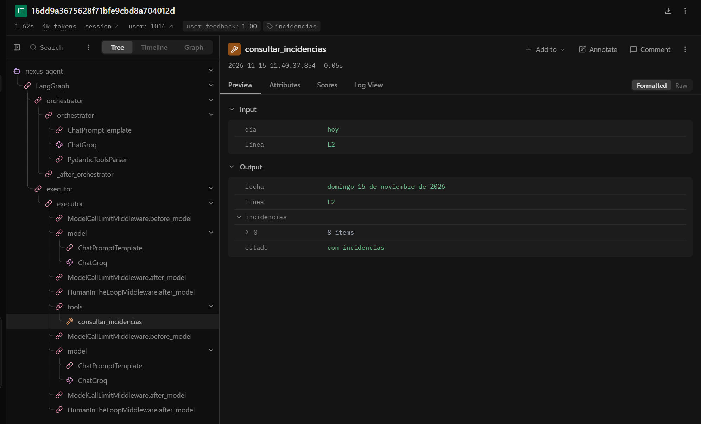

# 02 · El viajero enfadado

> «Tenemos una queja seria. Antes de tocar nada, quiero saber qué pasó y a cuántos
> viajeros más les ha pasado.»

**Ticket #4471 · viajero 1042 (Pere) · sesión** `f3524934fee165321b4fe0b66d593af7`**:**

> «El martes le pregunté a Nexus si la L3 funcionaba con normalidad el jueves y me dijo
> que sí. El jueves estaba cortada por obras y llegué tarde al trabajo.»

**Tiempo:** 45 minutos · **Comprobación:** `uv run check 2`

En el capítulo 1 miraste muchas trazas a la vez para comparar dos prompts. Ahora es al
revés: lees una sola conversación paso a paso hasta encontrar dónde se torció. Después
vuelves a mirar muchas, para saber a cuántos viajeros más les pasó lo mismo.

## Lo que necesitas saber

**Una traza es un árbol.** Cada conversación con Nexus es una traza, y dentro tiene
una *observation* por cada paso: la raíz es la conversación entera, debajo están el
orquestador y el executor, y dentro del executor las llamadas al modelo y a las
herramientas. Cada observation guarda su **entrada** y su **salida**. Este es un extracto
de cómo se ve una consulta de incidencias:

```text
nexus-agent                    la conversación: el mensaje del viajero y la respuesta
├─ orchestrator                ¿es una petición válida?
└─ executor
   ├─ (generación del modelo)  el modelo decide llamar a una herramienta
   ├─ consultar_incidencias    entrada: los argumentos · salida: lo que devolvió
   └─ (generación del modelo)  el modelo redacta la respuesta con esos datos
```

Así se ve en Langfuse. El árbol real tiene más nodos: los de LangGraph y los
*middlewares* (`ModelCallLimitMiddleware`, `HumanInTheLoopMiddleware`, `ChatPromptTemplate`…)
son fontanería interna. Fíjate en tres: las generaciones del modelo (`ChatGroq`), la
herramienta (`consultar_incidencias`) y, al seleccionar cualquiera, su **Input** y su
**Output** a la derecha.



> Para que el árbol quepa en pantalla, abre el menú **⋮** junto a *Search* y desactiva
> **Show Duration** y **Show Cost**: cada nodo ocupa una sola línea.

**Cada traza lleva quién y cuándo.** El *User ID* es el id del viajero (`1042` en el
caso de Pere) y cada conversación tiene su *Session*. El historial va del 26 de octubre
al 15 de noviembre de 2026; Langfuse enseña por defecto solo las últimas horas, así que
amplía siempre el filtro de fecha.

**Un incidente se investiga en cuatro pasos.**

| Paso | Qué haces | En Langfuse |
| --- | --- | --- |
| 1 · Localizar | Encontrar la conversación del ticket | Filtros por User ID, fecha y Session |
| 2 · Leer | Ver la entrada y la salida de cada paso | El árbol de la traza |
| 3 · Aislar | Encontrar el primer paso que se equivocó | Comparar lo que entra y lo que sale de cada observation |
| 4 · Medir | Contar a cuántos más les pasó | Filtros por nombre de observation y búsqueda en la entrada |

**La respuesta es el síntoma; la causa puede estar en cinco sitios.** Sube por el árbol
hasta el **primer paso que recibe algo correcto y devuelve algo incorrecto**: ahí está el
fallo.

| Componente | Síntoma típico | Qué mirar en la traza |
| --- | --- | --- |
| Orquestador | Rechaza algo válido o deja pasar algo ajeno | La salida de la generación del orquestador |
| Modelo | Ignora lo que dice la herramienta o se lo inventa | La salida de la herramienta frente al texto de la respuesta |
| Herramienta | Devuelve datos de otro día, línea o estación | La entrada de la herramienta frente a su salida |
| Datos | La herramienta funciona, pero el dato es viejo o falta | La salida de la herramienta frente a la fuente |
| Rendimiento | Tarda mucho o gasta muchos tokens | La línea de tiempo y el número de llamadas |

**Cada fallo encontrado se convierte en dos protecciones.** Un **test** reproduce el
fallo en el código: es rápido, no llama al modelo y salta en cuanto alguien lo
reintroduce. Un **caso en el dataset** comprueba la conversación de principio a fin, con
el modelo, en cada experimento. El test protege la pieza; el caso, el comportamiento.

## La misión

### En Langfuse

1. **Localiza la conversación.** En **Tracing**, pon un rango de fechas que incluya el

   martes 10 de noviembre de 2026 y filtra por **Session ID** con el id que trae el
    ticket, `f3524934fee165321b4fe0b66d593af7`. Pere ha hablado con Nexus más veces: si
    filtras solo por **User ID** `1042` verás todas sus conversaciones.

    Qué esperar: una sola traza `nexus-agent`, del martes 10 a las 07:52, con la pregunta
    de Pere sobre la L3.
2. **Lee el árbol.** Abre la traza y recorre cada observation, de arriba abajo. Para

   cada una, apunta qué recibió y qué devolvió.
3. **Aísla el fallo.** ¿En qué componente está? Escríbelo en una frase y

   justifícalo con una entrada y una salida concretas de la traza.
4. **Mide el alcance.** Ahora que sabes qué tipo de entrada provoca el fallo, busca las

   demás observations que lo pudieron sufrir. Cuenta cuántas trazas son y cuántos viajeros distintos.

    Después afina: ¿en todas esas trazas la respuesta tenía un dato equivocado? Separa las
    trazas **afectadas por el fallo** de las que acabaron con una **respuesta
    incorrecta**.

### En el código

1. **Reproduce el fallo con un test.** Modifica el test en la carpeta`tests/test_error_pere.py` con el caso de

   Pere: el martes 10 de noviembre, «jueves» tiene que ser el jueves 12. Lánzalo:

    Qué esperar: el test **falla**, y pytest enseña la fecha que devuelve ahora
    `resolve_day`. Un test que reproduce un fallo tiene que fallar antes del arreglo; si
    pasa, no está probando lo que crees.
2. **Corrige** `resolve_day` en [`nexus/calendar.py`](../nexus/calendar.py). Vuelve a

   lanzar el test hasta que pase y, después, todos:
3. **Añade el caso de Pere al dataset** `nexus/agente`, al final de `CASES` en

   [`evaluation/datasets/agente.py`](../evaluation/datasets/agente.py). Completa lo
    marcado con `...`:

    Cambia también el número de casos de la descripción del dataset (de 25 a 26) y
    súbelo:

    Qué esperar: en **Datasets**, `nexus/agente` tiene 26 casos.
4. **Pregúntale tú a Nexus** lo mismo que Pere, el mismo día:
   ```bash
    uv run agent --usuario 1042 --dia 2026-11-10
   ```

    Qué esperar: ahora habla de las obras del jueves 12 en la L3. La conversación queda
    en Langfuse, y puedes comparar su árbol con el de Pere.

Comprueba:

```bash
uv run check 2
```

### Nivel extra: la conversación de más de 40 segundos

Una traza del historial tarda más de 40 segundos y, aun así, acaba con una respuesta
razonable. Encuéntrala ordenando por latencia en **Tracing** y abre su **línea de
tiempo**. ¿Cuántas veces llama Nexus a la misma herramienta? ¿Con qué argumentos? ¿Qué
le contesta la herramienta cada vez?

Cuando lo entiendas, corrige [`nexus/tools/incidencias.py`](../nexus/tools/incidencias.py)
para que esa consulta no vuelva a entrar en bucle. `uv run check 2` lo marca como
`[nivel extra]`: se muestra, pero no cuenta para la misión.

## Sabrás que lo has hecho si…

- `uv run check 2` sale en verde.
- Puedes decir en una frase dónde estaba el fallo y enseñar la entrada y la salida que
lo demuestran.
- Sabes cuántas trazas y cuántos viajeros se vieron afectados, y cuántos de ellos
recibieron un dato equivocado.

Pista 1 · No encuentro la conversación de Pere

Revisa el filtro de fecha: tiene que incluir el martes 10 de noviembre de **2026**. El
Session ID es exactamente `f3524934fee165321b4fe0b66d593af7`. Si la lista sigue vacía,
quita los demás filtros.


Pista 2 · Todos los pasos parecen correctos

Para cada observation, escribe en una línea «recibió X, devolvió Y». Fíjate sobre todo en
los datos que Pere no escribió y que Nexus tuvo que calcular por su cuenta. ¿Alguna
salida no corresponde a lo que se pidió?


Pista 3 · Veo el fallo, pero no sé corregirlo

Llama a `resolve_day` con el caso de Pere y sigue sus valores intermedios con un `print`
o con el depurador. Al lado, apunta a mano lo que debería valer cada uno según un
calendario. ¿En qué línea deja de cuadrar?


Pista 4 · ¿Cómo cuento a cuántos más les pasó?

Filtra las observations por el nombre de las herramientas que reciben un día y busca en
la entrada el tipo de valor que provoca el fallo. ¿Todos los viajeros escriben en
castellano? Cuenta los User ID distintos. Para saber si la respuesta era incorrecta,
compara lo que devolvió la herramienta con lo que habría devuelto para el día correcto.


Pista 5 · El nivel extra sigue fallando

¿El problema es que el modelo insiste o que la herramienta le pide que insista? Busca en
el mismo módulo, y en los datos que usa, algo que ya sepa dar las incidencias de una
sola línea.


## Para pensar

- ¿Habría arreglado este fallo un prompt mejor? ¿Y un modelo más grande?
- La traza lenta acabó con una respuesta correcta. ¿Qué medida la habría detectado?

Siguiente: [03 · ¿Qué significa que Nexus va bien?](03-que-significa-que-nexus-va-bien.md).
